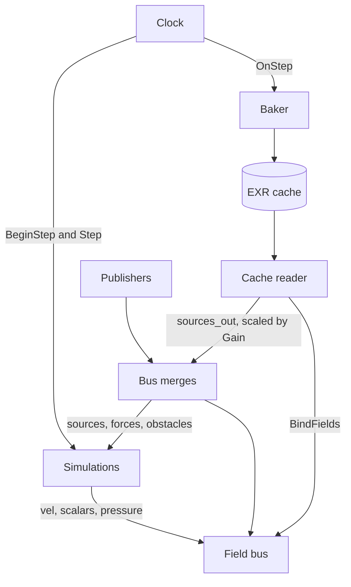

# td-simulations

Real-time and baked simulation for TouchDesigner. Phase 1 is the shared infrastructure and a 2D smoke/fire solver: a fixed-step clock, a field bus that later solvers will share, and an EXR cache that can resume exactly. Phase 2 adds a 3D fluid and a volume renderer. Phase 3 adds GPU particles that ride the same bus, collide with its obstacles, and push forces and heat back into it.

The solver runs one simulation step per TouchDesigner frame. In realtime that step is meant to hold 30 fps or better. In bake mode the project's real-time flag is turned off, every step is computed however long it takes, and the full fluid state is written to disk.

## Requirements

- TouchDesigner 2025. The network and the GPU probe were run on 2025.32820.
- Python 3.11 or newer, plus pytest, for the unit tests. `python/cache.py`, the `SimClock` dataclass, and the bus helpers import without TouchDesigner. The extension classes are only constructed inside TD.
- A td-mcp checkout named `td-mcp` next to this repo, or `$TD_MCP_HOME` pointing at one, for the scratch-TD scripts. The scripts look for `src/td_mcp/client.py` inside that checkout.
- A TouchDesigner install. The scratch launcher uses `$TD_BIN` when it is set, and otherwise the TouchDesigner application it finds on the machine.

No third-party Python packages are required inside TouchDesigner.

## Quick start

### Unit tests

```bash
python3 -m venv .venv
.venv/bin/pip install -e ".[dev]"
.venv/bin/python -m pytest -q
```

`pyproject.toml` puts `python/` and `scripts/` on the pytest path.

### Scratch TouchDesigner

The scratch scripts launch a private TouchDesigner through td-mcp. It gets its own port and a connection file under `.scratch/` (gitignored). TouchDesigner processes you already have open are left alone.

```bash
python scripts/td_scratch.py start
python scripts/build_project.py
```

`start` records the process in `.scratch/state.json`. Running it again reuses that process. `build_project.py` saves `sims.toe` into the repo root first, so `project.folder` is this repo, then builds `/sims`, registers the demo publishers, applies the realtime preset, and saves `tox/sims.tox`. Pass `--no-save` to build and check operator errors without writing those files. If `start` was not run, `build_project.py` launches a temporary instance and closes it when it finishes.

`python scripts/td_scratch.py stop` signals only the process group that `start` created.

### Opening the project

Open `sims.toe` in TouchDesigner and play the timeline. An Execute DAT on `/sims/clock` calls `op.simclock.Tick()` at frame start, which is the whole simulation step.

`/sims` has a folder parameter, Root, whose expression is `project.folder`. With `sims.toe` sitting in the repo, Root is the repo root. Shaders and extensions are text DATs synced to files under that root, and a start-up Execute DAT inserts `<Root>/python` at the front of `sys.path`. Cache paths that are not absolute are resolved against Root as well.

## Architecture



`python/build_network.py` builds this under `/sims` (parent shortcut `sims`):

| Operator | Role |
| --- | --- |
| `clock` | `SimClockExt`, global shortcut `op.simclock`. Ticks at frame start. |
| `bus` | `FieldBus`, global shortcut `op.simbus`. Holds the 2D grid, merges publishers, routes the active fluid fields. |
| `fluid2d` | 2D smoke/fire solver. |
| `demo` | An emitter (one sources TOP and one forces TOP) and a moving disc obstacle. |
| `bus3d` | `FieldBus3D`, global shortcut `op.simbus3d`. The 3D grid and the same publisher kinds. |
| `fluid3d` | 3D smoke/fire solver and volume render. |
| `demo3d` | A 3D emitter, moving sphere / box / capsule, and a mesh obstacle. |
| `particles` | GPU particles. Not stepped until a demo or a script adds them to the clock. |
| `demo_particles` | Presets: 2D embers from the fire, and 3D sparks. |
| `baker` | Writes `cache/fluid2d` by default. Point `Sim` at `fluid3d` to bake the volume. |
| `cache_reader` | Plays a cache back. 3D frames are slice atlases decoded to volumes. |

Extensions are promoted onto their COMPs, so `op.simclock.Tick()` and `op.simbus.Publish(...)` call the Python methods directly. Every shader and extension is a text DAT with its file synced from this repo; edits on disk show up in the project.

### Clock

One `Tick()` is one solver step. Output frame `f` is `substeps` steps long:

```text
dt    = 1 / (fps * substeps)
step  = (frame - start_frame) * substeps + substep
time  = step * dt          # 0 at start_frame
```

`frame` is `start_frame + step // substeps`. The step is the last substep of its frame when `substep == substeps - 1`. That is the state the baker saves.

`Tick()` runs from an Execute DAT at frame start, after parameters have cooked, and it cooks each simulation explicitly. That is what keeps the sim to exactly one step per TouchDesigner frame. A Feedback TOP only captures its target on frames it cooked itself, so `Fluid2D.Step` cooks `fb_vel`, `fb_scalars`, and `fb_pressure` directly. On a reset the loop Switch does not pull them.

A pending reset always runs on the next tick: the clock rewinds, sims get `BeginStep(True)`, and the step counter is not advanced on that tick. With no reset pending, a clock whose Running parameter is off returns without stepping. Listeners run after every sim has stepped. `AddListener` / `RemoveListener` edit the Listeners parameter (space-separated COMP paths). A listener COMP implements `OnStep(clock_ext)`. The baker registers itself this way.

| Parameter | Default | Meaning |
| --- | --- | --- |
| Fps | 60 | Output frames per second. |
| Substeps | 1 | Solver steps per output frame. Range 1–16. |
| Startframe | 0 | Frame number of step 0. |
| Mode | realtime | `realtime` or `bake`. |
| Seed | 0 | Stored on the clock and included in the fluid cache hash. |
| Running | on | With no reset pending, Tick steps only while this is on. |
| Reset | pulse | Rewinds to Start Frame on the next tick. |
| Sims | `/sims/fluid2d` | COMP paths to step, in order, separated by spaces. |
| Listeners | empty | COMP paths notified with `OnStep` after the sims. |
| Step, Frame, Substep, Time, Dt | read-only | Published at the start of the step, before sims cook. |

Shaders read the clock through two vec4 uniforms. `uClock` is dt, time, step, frame. `uClock2.x` is the seed (`BUS_SEED` in `shaders/common/bus.glsl`); yzw are reserved. The splat offsets its noise by that seed, so two seeds flicker differently. `SimClock.uniforms()` reports the same values as `uDt`, `uTime`, `uStep`, `uFrame`, and `uSeed`.

In realtime, Substeps is normally 1 and TouchDesigner's real-time flag is left as it is. In bake mode the baker turns that flag off for the duration of the bake and restores the previous value afterwards.

### Fluid step

Each fluid step, in order: RK2 semi-Lagrangian advection of velocity and scalars, a clamped MacCormack correction, combustion, body forces, divergence, a Jacobi pressure solve, and projection. Body forces are buoyancy, smoke weight, whatever the bus forces field contains, wind drag, and vorticity confinement. The pressure solve is warm-started from last step's pressure and runs `Jacobi` iterations (one GLSL TOP pass each; pass k reads pass k−1 through input 0). Projection subtracts the pressure gradient and clamps speed. Solid cells take the obstacle velocity and clear their scalars.

State lives in three Feedback TOPs. A Switch on each loop selects that feedback image, or the init image on a reset. Init is black, or a cache frame loaded into a Movie File In. Velocity is `rg32float`, stored scalars are `rgba16float` (the advection intermediates are `rgba32float`), and pressure is `mono32float`. Pressure has dt folded into it: the projection does `v -= grad(p)` with no extra factor of dt.

The feedback targets are the nulls `vel_state`, `scalars_state`, and `pressure_state`. The public `vel_out`, `scalars_out`, and `pressure_out` are Cache TOPs fed by those nulls. `Step` cooks the state nulls, turns each cache Active for one cook so it stores that image, then turns Active off. An inactive Cache TOP does not cook its input, so the bus, a viewer, or a numpy read of `*_out` cannot run the feedback loop again. That extra cook used to leave the live picture one step ahead of the frame the baker had just saved. `render_out` samples `scalars_out`, so it stays on the captured frame too.

The demo emitter is a flickering gaussian splat. The same shader writes sources or forces; the forces TOP uses it as an upward acceleration (`Lift`). The disc writes a signed-distance circle and the velocity of its centre, which moves on a sine in x. `build_project.py` publishes all three. Their parameters are on the demo COMP (Emitter and Disc pages).

## Field bus

The bus is the contract every simulation reads and writes. World space has +y up. Units are arbitrary as long as they match; the demo is set up in metres. Default bounds are (−1, 0) to (1, 2). Texel centres are at `vUV`. Shaders include the contract with `#include <bus_glsl>` (`shaders/common/bus.glsl`).

| Field | Format | Encoding |
| --- | --- | --- |
| `vel` | `rg32float` | Velocity, world units per second. |
| `scalars` | `rgba16float` | R smoke density, G temperature, B fuel, A expansion rate in 1/s (written by combustion). |
| `pressure` | `mono32float` | Pressure with dt folded in (`v -= grad p`). |
| `sources` | `rgba32float` | Per-second injection: R smoke, G heat, B fuel, A extra expansion in 1/s. |
| `forces` | `rgba32float` | XY acceleration, world units per second squared. |
| `obstacles` | `rgba32float` | R signed distance in world units (negative inside), GB obstacle velocity, A unused. |

`vel`, `scalars`, and `pressure` are selects from the active field source (`<Fieldsource>/vel_out` and the same for scalars and pressure). A live sim or a cache reader can be that source. `sources`, `forces`, and `obstacles` are merges of every publisher.

Publishers are TOPs at bus resolution. Registering one does not rewire the network: `Publish` appends a row to the `publishers` table (kind, path) and refreshes the merge TOP's `tops` parameter. Sources and forces are summed (`shaders/common/sum.glsl`), with a zero texture as input 0 so the resolution stays put. Obstacles keep the nearest signed distance and that obstacle's velocity (`shaders/common/sdf_union.glsl`); input 0 is an empty field at distance `1e4`. A GLSL TOP has three wired inputs, so further publishers arrive through `tops`. That is what lets the bus take any number of them.

```python
op.simbus.Publish("sources", op("/project1/my_emitter"))
op.simbus.Publish("forces", op("/project1/my_emitter_forces"))
op.simbus.Publish("obstacles", op("/project1/my_sdf"))
op.simbus.Unpublish(op("/project1/my_sdf"))            # every kind
op.simbus.Unpublish(op("/project1/my_emitter"), "sources")
```

`kind` is `sources`, `forces`, or `obstacles`. The argument is a TOP or a path string. Publishing a path that is already registered for that kind does not add a second row. `op.simbus.Publishers("sources")` returns the paths in registration order.

Grid parameters live on the bus. `SetGrid(width)` sets the width and chooses a height with square cells for the current bounds (`matched_height`). The presets use that. The solver treats cells as square: `busCell()` is the world size of one cell along x.

| Parameter | Default | Meaning |
| --- | --- | --- |
| Resw, Resh | 1024, 1024 | Grid resolution. |
| Boundsx0, Boundsy0, Boundsx1, Boundsy1 | −1, 0, 1, 2 | World bounds. |
| Wallleft, Wallright, Wallbottom, Walltop | on, on, on, off | Closed side (on) or open side (off). |
| Spongewidth | 0.35 | Width of the absorbing band on open sides, world units. |
| Spongerate | 4.0 | Fade rate inside that band, 1/s. |
| Fieldsource | `/sims/fluid2d` | COMP that provides `vel_out`, `scalars_out`, `pressure_out`. |

`op.simbus.BindFields(comp)` sets Fieldsource. `comp` is a COMP or a path.

Domain sides are walls in the divergence and pressure passes: neighbours outside the domain contribute no flow, and pressure is mirrored. A side marked open still behaves that way in the pressure solve. It also grows an absorbing band (`busSponge` in `bus.glsl`). Advection adds `Spongerate` to the decay of every channel there, so velocity and the scalar channels fade as they approach that side. A true open boundary, with pressure fixed at 0 past the edge, was unstable on this collocated grid once the plume reached it.

## Writing a simulation

The clock and the baker talk to a simulation COMP through six methods. Promote the extension the way `build_network.extension` does, then add the COMP's path to `op.simclock.par.Sims`.

| Method | Called by | Job |
| --- | --- | --- |
| `BeginStep(reset)` | Clock, before `Step` | `reset` is true on the tick that honours a reset. Select the init state for this step. |
| `Step()` | Clock | Cook exactly one step. |
| `StateTops()` | Baker | `{field name: TOP}` to save. |
| `StateFormats()` | Baker | `{field name: pixel format}` written into the manifest. |
| `SetInit(paths)` | Baker, before a reset | `None` means zeros. A dict `{field: exr path}` is the state to load for the next reset. |
| `Params()` | Baker | Everything that changes the result. The cache hash is this dict. |

To drive the bus, point the new COMP's field source with `BindFields`, or leave Fieldsource on `fluid2d` and only publish sources, forces, and obstacles. A COMP that wants to *be* the field source needs `vel_out`, `scalars_out`, and `pressure_out`.

`Params()` should include the grid, the clock rate, and the publisher list when those change the pixels. `Fluid2D.Params` records:

- the physics parameters, including `Jacobi`
- bus resolution, bounds, wall toggles, and sponge settings
- clock fps, substeps, and seed
- the publisher paths for sources, forces, and obstacles
- a 16-hex digest of the text DATs on the fluid COMP (the shaders and the extension source)

Look parameters and `Cookrender` are display-only and stay out of the hash. Publisher parameter values, and the shader text inside a publisher, also stay out of the hash: changing the demo emitter's heat does not mark an existing cache stale.

A simulation that should be rebuilt with the project is added in `python/build_network.py` and called from `build()`.

## Baking

The baker COMP steps the sim in bake mode and writes one EXR per state field per output frame, plus a manifest. The default target is the fluid2d COMP, into `cache/fluid2d` under Root. `cache/` is gitignored.

Pulse Bake. Status, Progress, and Eta update as frames land. Cancel stops early and leaves a partial cache. Clear Cache deletes the manifest and the frame files while a bake is not running.

| Parameter | Default | Meaning |
| --- | --- | --- |
| Sim | `/sims/fluid2d` | COMP with the six methods above. |
| Cachedir | `cache/fluid2d` | Relative paths resolve against `/sims` Root. Absolute paths are used as given. |
| Framestart, Frameend | 1, 120 | Inclusive output-frame range to save. |
| Warmup | 0 | Extra frames simulated before Framestart. They are not written. |
| Resume | on | Continue a partial cache. Off clears and starts over, including when the cache is already complete. |
| Async Save | off | `TOP.save(..., asynchronous=True)`. |
| Pause After Bake | on | Turn the clock's Running off when the bake ends, leaving the last baked state in the sim. |
| Bake, Cancel, Clear Cache | pulses | Start, stop, delete. |
| Status, Progress, Eta | read-only | Progress is the fraction of the frame range written. Eta is seconds remaining. |

What Bake does:

1. If a bake is already running, it returns.
2. It builds a manifest from `Params()`, `StateFormats()`, the bus grid, the clock fps and substeps, and Framestart/Frameend. `td_version` is TouchDesigner's version and build joined with a dot.
3. If `cache_status` is complete and Resume is on, Status becomes `complete (nothing to do)` and it returns.
4. If the cache is missing or stale, or Resume is off, it deletes the cache and starts at Framestart. Otherwise it keeps the files. A longer Frameend updates the manifest's `frame_end` and continues from the first missing frame. A shorter Frameend is written as the stop point so the bake does not simulate past it; when that prefix is already complete, Bake returns without changing the manifest.
5. It writes the manifest with `complete` false.
6. It remembers Start Frame, Mode, and Running, then sets Start Frame to Framestart minus Warmup. On a fresh run it clears init to zeros and resets the clock to that earlier frame, so the warmup steps cook before the first saved frame. On a resume past Framestart it points `SetInit` at the previous frame's EXRs and resets to the resume frame. Warmup is not replayed on resume.
7. It remembers `project.realTime`, turns it off, sets the clock Mode to `bake` and Running on, and adds itself as a listener.
8. After each step, if this step finishes an output frame at or after Framestart, it saves every state TOP. The manifest is rewritten every 10 saved frames and on the last frame.
9. At Frameend, or on Cancel, it drops the listener, restores Start Frame, Mode, and Running (Running is forced off when Pause After Bake is on), restores `project.realTime`, and sets `complete` only when every frame file through the manifest's `frame_end` is on disk.

The clock parameters changed for the bake are put back when it ends. The real-time flag is restored as well.

Every saved frame holds the full state (velocity, scalars, pressure), so a resume loads the last complete frame and continues. `scripts/bake_check.py` checks that a cancel-and-resume cache is byte-identical to a bake that ran straight through.

### Cache layout

```text
<cache_dir>/manifest.json
<cache_dir>/<field>/<field>.<frame:05d>.exr
```

Frame 12 of velocity is `vel/vel.00012.exr`. The manifest is written atomically (a temp file, then replace) so a crash cannot leave a truncated JSON file.

| Field | Meaning |
| --- | --- |
| `sim` | COMP name, such as `fluid2d`. |
| `params` | The dict from `Params()`. |
| `param_hash` | First 16 hex digits of the SHA-256 of the canonical params. Floats are rounded to 9 significant digits; key order does not matter. |
| `fields` | Field name to pixel format. |
| `res` | `[width, height]` or `[width, height, depth]`. |
| `bounds` | World bounds, 4 values in 2D or 6 in 3D. |
| `fps`, `substeps`, `dt` | `dt` is `1 / (fps * substeps)` and is written for convenience. Readers ignore it. |
| `frame_start`, `frame_end` | Inclusive range. |
| `version` | Cache layout version (`1`). A mismatch is stale. |
| `complete` | Set by the baker when a run finishes with every frame present. |
| `frames_written` | `frame - frame_start + 1` for the frame just saved. |
| `td_version` | TouchDesigner version and build. |
| `extra` | Free-form dict. The baker leaves it empty. |

### Stale, partial, complete, resume

`cache_status(cache_dir, params, frame_start, frame_end)` looks at the manifest and the files:

| Status | Meaning |
| --- | --- |
| `missing` | No readable manifest. |
| `stale` | `version` or `param_hash` differs, or `frame_start` differs. |
| `partial` | Same identity, and at least one frame in the requested range is missing a field file. A longer `frame_end` than the manifest is partial, not stale: the extra frames count as missing. |
| `complete` | Every field file exists from the requested `frame_start` through the requested `frame_end`. A shorter request is complete once that prefix exists, even if the manifest records a longer range. |

`plan_bake` in `python/cache.py` is the decision Bake uses. A stale or missing cache, and any bake with Resume off, is deleted and rewritten from Framestart. Anything else keeps the files and starts at the first requested frame that is missing any field. If frames 1 and 2 exist and frame 3 is missing velocity, resume starts at 3, even if later frames happen to be on disk. Extending Frameend on a finished cache resumes at the old `frame_end + 1` and updates the manifest's `frame_end`. Asking for an earlier end does not simulate past that end. When every requested frame exists, the plan is complete and Bake does nothing if Resume is on.

`clear_cache` removes `manifest.json` and `<field>/<field>.*.exr` only. Other files in a field directory are left alone, and an emptied field directory is removed. Given a manifest, only those fields are touched. Called with no manifest, every subdirectory is treated as a field. The baker passes the on-disk manifest when it has one.

### Disk estimate

`cache.estimate_bytes(res, fields, frames)` is an uncompressed upper bound. Zip EXRs of smoke usually land around 30–70% of it. Bytes per pixel are `rgba32float` 16, `rgba16float` 8, `rg32float` 8, `rg16float` 4, `mono32float` 4, `mono16float` 2, `rgba8fixed` 4; an unknown format counts as 16. A 3D `res` multiplies all three axes.

The default fluid state at 1024×1024 is 20 bytes per pixel (`rg32float` + `rgba16float` + `mono32float`). For 120 frames:

```python
from cache import estimate_bytes
estimate_bytes(
    [1024, 1024],
    {"vel": "rg32float", "scalars": "rgba16float", "pressure": "mono32float"},
    120,
)  # 2516582400
```

Run that with `PYTHONPATH=python` from the repo, or inside TouchDesigner after Root's python directory is on `sys.path`.

## Playback

The cache reader plays a bake back onto the bus. It exposes the same `vel_out`, `scalars_out`, and `pressure_out` TOPs as a live sim.

```python
reader = op("/sims/cache_reader")
reader.par.Cachedir = "cache/fluid2d"
reader.Reload()
op.simbus.BindFields(reader)
```

`BindFields("/sims/fluid2d")` points the bus back at the live solver.

Each state field has two Movie File In TOPs, blended by a Cross TOP. `Path(field, 0)` and `Path(field, 1)` are the two EXRs around the current frame. `Weight()` is the blend toward the later frame. `blend_frames` clamps to the reader's frame range; on an integer frame the weight is 0, so the image is that frame. Interpolate off forces the weight to 0. `Load(frame)` sets Frame and cooks the movie, cross, and output TOPs immediately.

| Parameter | Default | Meaning |
| --- | --- | --- |
| Cachedir | `cache/fluid2d` | Relative paths resolve against Root, same as the baker. |
| Frame | clock frame | Float. The expression is `op.simclock.par.Frame`. Clear the expression to scrub. |
| Interpolate | on | Blend neighbouring frames. |
| Reload | pulse | Reread the manifest. Also runs from the extension's `__init__`. |
| Gain | 1, 1, 1, 0 | Per-channel scale on `sources_out` (smoke, heat, fuel, expansion). |
| Status, Framestart, Frameend | read-only | Filled in by Reload. |

Reload with no manifest sets Status to `no cache at <dir>`. Otherwise Framestart comes from the manifest, and Frameend is the frame before the first gap (`resume_frame - 1`), raised to Framestart when that prefix is empty. Status looks like `fluid2d 1024x1024 complete`, or `fluid2d 1024x1024 partial (N of M frames)` where N is the length of that prefix and M is the manifest's frame count. The word "complete" follows the manifest flag.

`sources_out` is the cached scalars multiplied by Gain (`shaders/common/scale.glsl`). The solver treats sources as per-second rates (`density += source * dt`), so a Gain of 1 injects the cached smoke, heat, and fuel as rates, and the default 0 on the fourth channel injects no extra expansion. The reader does not publish this TOP. To feed a live sim:

```python
op.simbus.Publish("sources", op("/sims/cache_reader/sources_out"))
```

The reader's `render_out` uses the live fluid2d look parameters and the live bus obstacles, so with Interpolate off it matches `fluid2d/render_out` for the same frame.

## Fluid2D parameters

Names below are the custom parameter names. Look parameters are not part of the cache hash. Physics parameters, `Jacobi`, and the registered publishers are. For each publisher the hash includes the GLSL vec uniforms other than `uClock` and `uClock2` (an expression is stored as its text, a constant as its value), the owning COMP's custom parameter values, and a digest of the pixel shader. That is why changing the demo emitter's Fuel or the disc's Discspeed makes a finished cache stale, while the disc's motion over time does not.

### Sim

| Parameter | Default | Meaning |
| --- | --- | --- |
| Preset | realtime | Menu: `preview`, `realtime`, `bake`. |
| Applypreset | pulse | Calls `ApplyPreset` with the current Preset value. |
| Jacobi | 30 | Pressure iterations per step (1–200). |
| Cookrender | on | `Step` also cooks `render_out`. |

### Physics

| Parameter | Default | Meaning |
| --- | --- | --- |
| Velocitydecay | 0 | Exponential velocity decay, 1/s, on both components. |
| Smokedecay | 0.25 | Exponential smoke decay during advection, 1/s. |
| Fueldecay | 0.5 | Exponential fuel decay during advection, 1/s. |
| Maccormack | 1 | MacCormack correction strength, 0–1. 0 keeps the semi-Lagrangian result. |
| Burnrate | 4 | Fuel burn rate above the ignition temperature, 1/s. |
| Burnheat | 2.5 | Heat added per unit of fuel burned. |
| Burnsmoke | 0.35 | Smoke added per unit of fuel burned. |
| Ignition | 0.15 | Temperature where fuel starts burning. |
| Cooling | 1.5 | Exponential temperature cooling, 1/s, applied after burning. |
| Expansion | 0.08 | Divergence added per unit of fuel burned. |
| Maxtemp | 6 | Temperature cap after cooling. |
| Buoyancy | 1.4 | Upward acceleration per unit temperature. |
| Weight | 0.1 | Downward acceleration per unit smoke. |
| Vorticity | 2.5 | Vorticity confinement strength. 0 turns it off. |
| Windx, Windy | 0, 0 | Wind velocity, world units per second. |
| Winddrag | 0 | Rate at which velocity blends toward the wind, 1/s. |
| Maxspeed | 20 | Speed clamp after projection, world units per second. |

### Look

| Parameter | Default | Meaning |
| --- | --- | --- |
| Smokedensity | 1.8 | How quickly smoke becomes opaque. |
| Fireintensity | 1.4 | Scale on the blackbody emission. |
| Whitehot | 2 | Temperature that maps to full white-hot. |
| Obstacleopacity | 0.8 | Grey overlay on solid cells. |
| Background | 0.02 | Background brightness behind the smoke. |
| Smokecolor | 0.55, 0.55, 0.6 | Smoke albedo. |

Temperature has no advection decay of its own; it cools in the combustion pass. Inside solids the rendered colour is mixed toward grey.

## Presets

`ApplyPreset` sets the bus width (height follows the bounds so cells stay square), the clock's Substeps, the Jacobi count, and the Preset menu. It does not change fps or the physics coefficients. Default bounds are square in world space, so height equals width.

| Preset | Width | Substeps | Jacobi |
| --- | --- | --- | --- |
| preview | 512 | 1 | 20 |
| realtime | 1024 | 1 | 30 |
| bake | 2048 | 4 | 80 |

Substeps is a clock parameter, so the bake preset slows the timestep for every sim the clock steps. At 60 fps the bake preset's dt is 1/240, and the baker still writes one file set per output frame, after the last substep.

## Scripts

All of these talk to a scratch TouchDesigner. `build_project.py` and `probe_gpu.py` launch one if `td_scratch.py start` is not already running. `sim_stats.py` and `bake_check.py` only attach to one that is already up.

| Script | Use |
| --- | --- |
| `scripts/td_scratch.py` | `start`, `stop`, `status`, `run <file.py>` or `run -` for stdin. An optional extra argument on `run` is the timeout in seconds. |
| `scripts/build_project.py` | Build `/sims` and save `sims.toe` and `tox/sims.tox`. `--no-save` checks only. Replaces an existing `/sims`. The saved project stores the td-mcp debug component with a blank Token; it generates a new one on startup. |
| `scripts/probe_gpu.py` | Write `reports/gpu_probe.json`. The temporary `/probe` network is destroyed afterwards. |
| `scripts/sim_stats.py` | `Vorticity=0 Maccormack=0 --seconds 4 [--png reports/x.png]`. Resets the fluid with those physics overrides, waits, prints speed, divergence, and scalar stats. |
| `scripts/bake_check.py` | `[--frames 40] [--preset realtime]`. Full bake, cancel-and-resume, staleness, and cache playback. Writes `reports/bake_check.json`. |

`td_scratch.py` can also be imported: `scratch_td()` launches and kills a fresh instance, `attach()` returns the one `start` recorded.

## GPU probe

Probed on an Apple M4 Max, TouchDesigner 2025.32820, Vulkan over Metal, macOS 15.5. The record is `reports/gpu_probe.json`.

These worked:

- 2D compute shaders, including negatives and values above 1, in 32-bit float.
- 3D textures. A compute shader wrote a volume and a pixel shader read a slice back.
- Multi-pass pixel shaders. Pass k reads pass k−1 through input 0, which is what the Jacobi solve uses. `uTDPass` is the pass index: over four passes the green channel summed to 6, which is 0+1+2+3.
- Multi-pass compute with in-place read-write.
- Shared-memory integer atomics.
- EXR round-trips, bit-exact (max absolute difference 0) for `rgba32float`, `rgba16float`, `rg32float`, and `mono32float`.
- Asynchronous `TOP.save`.

These did not:

- TouchDesigner atomic counters. The test shader failed to compile because `counter` was undeclared. Shared-memory atomics cover the workgroup reductions this project needs.
- Float image atomics. `GL_EXT_shader_atomic_float` is not supported on this GPU, so a FLIP particle-to-grid scatter cannot atomic-add into a texture. Particle-to-grid will be a gather over binned particles.
- Movie File In on EXRs only a few rows tall. 64×32 and 256×8 failed to open. 96×96 and larger loaded.

## 3D smoke and fire

`/sims/bus3d` (`op.simbus3d`) is a second bus. The 2D bus is unchanged. Publishers use the same `Publish(kind, top)` table and merge TOPs; the merges are compute shaders writing `texture3d`. World axes are the same (+y up) with a z extent. Default bounds are (−1, 0, −1) to (1, 2, 1), so a cubic grid has cubic cells. Default resolution is 128³. An open side is a Dirichlet pressure boundary (ghost pressure 0) and an absorbing band. A closed side is a Neumann wall. Front and back (`Wallfront`, `Wallback`) default closed, and the top defaults open.

Shaders include the contract with `#include <bus3d_glsl>`.

| Field | Format | Encoding |
| --- | --- | --- |
| `vel` | `rgba16float` | xyz velocity, world units per second. w is unused. |
| `scalars` | `rgba16float` | Same channels as 2D: smoke, temperature, fuel, expansion. |
| `pressure` | `mono32float` | Pressure with dt folded in. |
| `sources` | `rgba32float` | Per-second smoke, heat, fuel, extra expansion. |
| `forces` | `rgba32float` | xyz acceleration. |
| `obstacles` | `rgba32float` | r signed distance (negative inside), gba obstacle velocity. |

`vel` is half precision because speeds in this sim sit well inside the half range and the cache round-trip has to be bit-exact with the persistent state. Pressure stays 32-bit.

A Feedback TOP does not capture a 3D target on this GPU: it passes its input through and the value does not accumulate. Each fluid field is a pair of Cache TOPs. `Step` reads one and writes the other (`Replace` on, so the single cached frame is overwritten). The public `vel_out`, `scalars_out`, and `pressure_out` are selects of the cache just written. An inactive Cache TOP keeps the 3D image, and reading it does not recook the solver.

`fluid3d` has the same six methods as `fluid2d`, so the clock and the baker drive it. The clock's Sims parameter stays `/sims/fluid2d` after a build, so phase 1 keeps its timing. To run the volume:

```python
op.simclock.par.Sims = "/sims/fluid3d"
op("/sims/fluid3d").ApplyPreset("realtime")
```

The step is RK2 semi-Lagrangian advection, optional MacCormack, combustion, buoyancy and vorticity confinement, divergence, a pressure solve, and projection. Vorticity is faded within a couple of cells of a solid; the obstacle surface is a one-cell vortex sheet and confinement there runs away.

### Pressure

`Solver` is `jacobi` or `multigrid`. The divergence and the pressure gradient are adjoints of the compact 7-point Laplacian. Each fluid cell owns the face on its +side: the flux is that cell's velocity when the neighbour is fluid, the obstacle velocity when either side is solid, and 0 on a closed domain face. An open domain face uses ghost pressure 0 and lets the fluid leave. Projection subtracts the forward difference of pressure across that face. A centred difference over two cells does not match this matrix, which is why the old Jacobi step barely moved the measured divergence. The right-hand side is velocity divergence minus the expansion stored in `scalars.a`. With Neumann walls on every side that right-hand side does not sum to zero (combustion and inflow add mass), so the Poisson problem has no solution and a residual floor is left behind. The open top removes that null space.

Jacobi is one compute TOP, `Jacobi` passes. The realtime preset uses it so the 128³ view stays above 30 fps.

Multigrid is a geometric V-cycle down to a 4³–8³ grid. Restriction is full weighting of the residual, prolongation is trilinear, and `Coarsegain` is 1. Smoothing is weighted Jacobi (omega 2/3), `Smooth` passes before restriction and again after prolongation. The coarsest level runs `Coarse` iterations at spacing 2h, 4h, and so on. `Vcycles` 4 runs four cycles (`a_*` through `d_*`); unused cycles stay bypassed. Bake mode uses that solve. The measured quantity is the RMS of `div(u) - expansion` on every projection, with no cutoff on the incoming field. A manufactured zero-mean sine mode on the numpy V-cycle (all-Neumann, mean removed, 32³) drops about 4.1× per cycle with 4 smoothing sweeps and about 9.2× per cycle with 14; a solid block in the box stays around 8.6–9.1× at 14 sweeps. On the live fire the first GPU cycle does most of the work (about 46× at 128³ and 30× at 256³ on the last step of the sample) and the later cycles keep cutting the remainder. `scripts/validate_phase4.py` records the median and the 99th-percentile reduction.

### Obstacles

`demo3d` publishes four obstacle fields:

- Analytic sphere, box, and capsule. Each has a centre (or axis), a radius, and a velocity. The demo moves them with a sine so the velocity matches the derivative.
- A mesh. `RebuildMesh` reads a SOP, or a POP through `poptoSOP`, fan-triangulates it, and jump-floods a signed distance in the mesh's local bounds. The flood is one compute TOP: clear, a single thread rasterises the triangles into a surface band, then log₂(N) jump steps. The result is snapshotted into `sdf_hold`. Every frame the publisher only transforms that volume (translation, yaw, scale) and writes distance plus rigid velocity. A moving mesh stays cheap. `Triangles(geo)` is the same conversion and is what the phase 2 check uses for both the sphere SOP and the box POP.

Inside an obstacle the solver writes the obstacle velocity and clears the scalars, same as 2D.

### Volume render

`render_out` is a raymarched GLSL TOP. Default camera is an orbit (`Camaz`, `Camel`, `Camdist`, `Camfov`) around `Target`. Smoke absorbs, temperature emits through the same blackbody ramp as 2D, and a shadow volume marched along `Light` multiplies the emission. Obstacle surfaces are shaded with the SDF gradient. Output size is `Renderw` × `Renderh` (default 1280×720). The march uses `Raysteps`, capped at 56 so the loop has a fixed bound (variable bounds were much slower on this GPU). The shadow march is 8 steps.

### 3D caches

State is not saved as a 3D EXR. `fluid3d` encodes each volume to a 2D slice atlas (`vel_atlas`, and the same for scalars and pressure) and those are what the baker writes. `cache.atlas_layout` picks the tile grid. 128³ packs as 8×16 tiles, 1024×2048, which is exactly the voxel count. Both atlas edges are padded out to at least 256 pixels: Movie File In on this machine opens rgba16float EXRs at 256×256 and fails at 256×128 and 128×128. `estimate_bytes` uses the atlas pixel count, so a padded volume is larger than `width * height * depth`.

The manifest's `res` is `[width, height, depth]` and `extra.atlas` stores the layout the file was written with. `CacheReader.Reload` builds a decode compute TOP per field (`{field}_vol`). `Output(field)` returns that volume for a 3D manifest and the usual `{field}_out` for a 2D one. The 2D reader wiring is unchanged. Movie File In is created with `playmode` locked so its default index expression cannot rewrite the frame number in the filename.

`cache/phase2_full` is the validation bake. A 24-frame realtime bake is the showcase; delete it when `cache/` would pass 30 GB.

## Particles

`/sims/particles` is a fixed pool of GPU particles. The default grid is 1024×1024, which is 1,048,576 particles. State is two float textures, `pos` (xyz position, age in seconds) and `pvel` (xyz velocity, life remaining in seconds). A life of 0 is a dead particle waiting to respawn. The textures are the baker's state, so a particle bake is the same EXR cache as a fluid bake: point the baker's Sim at `/sims/particles`.

The clock contract matches the fluids (`BeginStep`, `Step`, `StateTops`, `StateFormats`, `SetInit`, `Params`). The public `pos_out` and `pvel_out` are locked copies. Reading them does not advance the simulation. The previous step is what the next step reads, also locked, because a Feedback TOP in this network kept only one capture.

`Bus` chooses `2d` (`op.simbus`) or `3d` (`op.simbus3d`). Each step samples that bus for velocity, temperature, and the obstacle field. Drag is integrated semi-implicitly and the other accelerations (gravity, buoyancy, turbulence) are an RK2 sample. `Velmode` can replace the bus velocity with a constant vector or a solid-body rotation, which is how the path check is run. Collisions push a particle out along the obstacle gradient, then apply restitution, friction, and the obstacle velocity. `Radius` below 0 disables collisions.

Emitters are point, sphere, box, fire, and smoke. Fire and smoke respawn dead particles on the scalar field (temperature × fuel, or smoke density) and fall back to the sphere when the field is cold. The tracer emitter places one particle at `Spawn` and leaves the rest dead. Randomness is a seeded integer hash, so a bake repeats.

`Couplingstrength` and `Srcheat` publish into the selected bus. `Bind()` registers `forces` and `sources`; `Unbind()` removes them. The force on the fluid is the drag reaction scaled by particle mass over the mass of fluid in the cell. `Particlemass` is in nanograms, so 1 is 10⁻⁹ kg, and that mass is divided by `Density * cell volume`. A cloud of light embers does not blow the plume apart. Heat and smoke use the same scale. Strength 1 is the default; raising it makes the push larger. The splat is instanced point rendering with additive blending into a float target. In 3D the target is a slice atlas decoded to a volume at the bus resolution. There are no float image atomics on this GPU.

Fire and smoke emitters start dead. Each step a fraction of them is born in hot cells (or smoky cells) with the local fluid velocity plus a small jitter, so they stream up with the plume instead of bursting outward from a sphere.

```python
op('/sims/demo_particles').ApplyDemo('embers2d')   # or 'sparks3d'
op.simclock.RequestReset()
```

`embers2d` steps the particles and the 2D fire, with sparks that leave the emitter and slide around the disc. `sparks3d` does the same with the volume and the sphere. `Rendermode` is `points` (the sprite render alone), `composite` (sprites added over the fluid picture), or `emissive` (a short raymarch of the particle heat volume added over the 3D picture).

To bake one sim, set the baker's Sim to that component and leave Group Sims empty. To bake every sim that interacts, set Group Sims to the same list the clock steps, for example `/sims/fluid2d /sims/particles`. The group cache keeps one manifest whose hash covers every member, and writes each sim's fields under its own subfolder. Resume restores every member at the last complete frame, including the force grid the fluid step consumed. The cache reader's Member parameter selects which sim to play back. A single-sim cache (Group Sims empty) is unchanged: fields live directly under the cache directory, which is what the phase 1 and phase 2 checks use. A group bake steps from `PumpOnce` with the timeline execute off. Particle state textures need both edges at least 256 or the resume loader misreads the EXR.

Leave the reader's `Frame` expression on `op.simclock.par.Frame` and the clock seed at 0 before a fluid bake check. A particle test that points the reader at its own cache, or that leaves the seed at 1, makes the next fluid resume diverge.

`scripts/validate_phase3.py` (Apple M4 Max, TouchDesigner 2025.32820, steps equal frames), run twice back to back in one scratch session, passed both times. 1,048,576 particles integrated at 121.67 fps and drew at 121 fps. With the 1024² fluid and coupling on, the rate was 45 fps. With the 128³ volume, coupling off, it was 88 fps. A constant-velocity tracer landed 9.5e-8 off the analytic point. No living particle sat more than one cell inside an obstacle.

At the default coupling the fluid's mean absolute velocity change was 0.0041 and its peak speed was 1.014 times the uncoupled run. At 10× strength the mean change was 0.0079, still finite, and the peak force rose from 0.0010 to 0.010. On the ember picture the lit-sprite centroid was at y = 0.98 against an emitter at y = 0.22, and 78% of those pixels sat in the fire. A 40-frame group bake of the 2D fluid plus particles, cancelled and resumed, matched the uninterrupted cache byte for byte, and both members replayed exactly. `bake_check.py --frames 40` and `validate_phase2.py` still passed. `cache/phase3_showcase` is the 8-frame particle bake.

## 3D presets

`ApplyPreset` sets the cubic resolution, the multigrid iteration counts, the ray budget, and Jacobi. Preview and realtime leave `Solver` on Jacobi and do not change the clock substeps. Bake selects multigrid and sets substeps to 2, so it does change the timestep of every sim the clock steps, the same way the 2D bake preset does.

### High-resolution bakes

`/sims/demo_bake` Apply points the baker at `fluid3d`, selects the bake preset, and turns on a reduced cache: a full velocity/scalars/pressure keyframe every `Keyinterval` frames, scalars only in between, with those scalar frames cropped to the occupied box (`extra.bboxes` in the manifest). Resume loads the latest keyframe and re-simulates forward. `cache.estimate_bytes` takes the same `storage` and `bboxes`. The cache reader expands a cropped frame back to the full volume.

Playback detail is `Detail` on the volume shader: a small advected warp of the sample plus grain on the smoke that was actually hit. `Detail` 0 is the cached field unchanged. The realtime 128³ preset does not need it.

`scripts/validate_phase4.py` checks the pressure ratio, a 24-frame 256³ cancel-and-resume, cache bytes against the estimate, playback rate, and the upres picture, then runs `bake_check`, `validate_phase2`, `validate_phase3`, the shader check, and pytest.

The bake projection is scored on every step, not on a subset of the sample. On the M4 Max the median RMS reduction of `div(u) - expansion` was 108× at 128³ (1.84 per GPU-ms, against Jacobi 12 at 0.16) and 97.8× at 256³ (0.27 per GPU-ms, against 0.023). The 99th percentile of `|div|` over the whole volume, which is mostly empty cells, dropped by a median of 14.0× at 128³ and 12.0× at 256³. The multigrid step is about 17 fps at 128³ and 2.8 fps at 256³, so the realtime preset stays on Jacobi (the phase 2 render check still clears 30 fps). A 24-frame reduced 256³ cache was 14.8 MB/frame and byte-identical across cancel-and-resume. The 120-frame showcase is about 2.4 GB. Playback sat on the 120 fps cap. A 384³ Jacobi step and a 512×512×256 Jacobi step both stayed finite.

| Preset | Grid | Solver | Jacobi | Smooth | Coarse | V-cycles | Substeps |
| --- | --- | --- | --- | --- | --- | --- | --- |
| preview | 96³ | Jacobi | 12 | 4 | 24 | 1 | 1 |
| realtime | 128³ | Jacobi | 16 | 4 | 32 | 1 | 1 |
| bake | 256³ | multigrid | 24 | 14 | 40 | 4 | 2 |
| high | 384³ | multigrid | 16 | 14 | 40 | 4 | 1 |

## Known limitations

**Open sides.** In 2D the pressure solve still treats every edge as a wall, and an open side only adds extra decay across `Spongewidth`. A pressure of 0 past the edge was unstable on that collocated grid. In 3D an open side is a Dirichlet pressure boundary (ghost pressure 0) as well as the absorbing band. That is what makes the pressure problem solvable when combustion adds divergence. The realtime preset stays on Jacobi and still has to hold 30 fps.

**The 2D pressure solver is Jacobi with a fixed iteration count.** The 2D residual at high resolution is whatever `Jacobi` iterations can remove from a warm start. The 2D bake preset uses 80 iterations; the realtime preset uses 30. The 3D bake preset uses the V-cycle described above.

**The 3D particle splat does not hold 30 fps at a million particles.** Advecting those particles beside the 128³ volume render does. Drawing every particle into the slice atlas is a second full-frame pass and drops the combined rate well below 30. Leave `Coupling` at 0 when the volume has to keep that rate. The 2D splat, into the 1024² bus, stays above 30 fps together with the realtime fluid. Two-way coupling is measured with the 2D bus.

**Bakes run offline.** The real-time flag stays off until the bake finishes or is cancelled, and each saved frame is a full set of EXRs. How fast that goes is in the benchmark reports below, not a fixed property of the solver.

**Short EXRs do not play back.** The cache reader uses Movie File In. Grids only a few rows tall fail to open (seen at 64×32 and 256×8). For rgba32float, 96×96 and up are fine. rgba16float is stricter on this machine: 128×128 and 256×128 failed, 256×256 and up loaded. 3D atlases are padded so both edges are at least 256. Saving those EXRs from a GLSL TOP still works; the failure is on the way back in.

**Root defaults to `project.folder`.** That is correct when `sims.toe` lives in this repo. A project whose folder is somewhere else will sync shaders, extensions, and relative cache paths against that other folder.

**Async Save can report complete early.** It returns before the file is necessarily on disk, and the baker decides `complete` as soon as the last `save` returns. Leave it off when the manifest flag has to match the directory.

## Roadmap

Later phases add the other solvers, all of them publishing onto this bus:

- Destruction: Voronoi fracture in pure Python, rigid-body dynamics in Bullet. The pieces become moving obstacles on this bus, and the particle system is what turns the debris into dust.
- FLIP liquids. Particle-to-grid will gather binned particles, because float image atomics are unavailable. The phase 3 splat is the additive-blend half of that; a liquid needs the gather.

## Benchmarks

Measured on an Apple M4 Max in TouchDesigner 2025.32820, with other TouchDesigner processes sharing the GPU. The raw records are `reports/bench_fluid2d.json`, `reports/bake_check.json`, and the 2048 bake described below. `gpuCookTime` on the multipass Jacobi TOP latched at 9.233 ms for every resolution, and the 2048 sample repeated the 1536 sample, so those GPU sums are not a resolution comparison. The frame rates are the numbers that tracked size.

Uncapped means `project.realTime` off for about 3 seconds. Preview and realtime both sat at about 120 fps, which matches a 120 Hz refresh cap, so those two rates are a floor on throughput rather than a measured ceiling. 1536 ran at 87 fps and 2048 at 38 fps, under that cap. Realtime means `project.realTime` on at cook rate 60. At 1024 the clock stepped at the same 60 fps as the timeline. At 2048 the timeline still advanced at 60 fps while the clock completed 42 steps per second.

| Run | Grid | Substeps | Jacobi | Uncapped fps | Realtime fps | Sim steps/s at cook rate 60 |
| --- | --- | --- | --- | --- | --- | --- |
| preview | 512 | 1 | 20 | 119.1 | 60.0 | 60.0 |
| realtime | 1024 | 1 | 30 | 120.0 | 60.0 | 60.0 |
| wider | 1536 | 1 | 30 | 87.1 | 60.0 | 60.0 |
| wider | 2048 | 1 | 30 | 37.9 | 60.0 | 41.9 |

`bake_check.py --frames 40` on the realtime preset: 40 frames in 5.35 s (7.48 fps), 120 EXRs, 214,095,940 bytes. Cancel and resume were byte-identical. Replaying the last frame through the cache reader matched the live render (max abs diff 0). A half frame differed from the average of its neighbours by 8.54e-4.

The bake preset (2048, 4 substeps, 80 Jacobi), frames 1–60 into `cache/fluid2d_bake`: 36.7 s, 1.63 fps, 180 EXRs, 2,439,256,927 bytes. `reports/frame_bake.png` is the last frame.

### 3D

`scripts/validate_phase2.py` (exit 0, `reports/phase2.json`). `reports/phase2_fire.png` is step 200, when the plume is up around the obstacles. `reports/phase2_late.png` is step 600.

600 steps at 128³ stayed finite. Speed touched the clamp of 6 and ended at 2.63. Temperature stayed between about 3.5 and 5.3. The moving sphere and the mesh were negative inside (signed distance −0.169 and −0.198) and smoke in those cells was 0. A box POP converted to 12 triangles; the sphere SOP to 80.

Uncapped (`project.realTime` off, volume render cooking): the realtime preset (128³, Jacobi 16, 48 ray steps, 1280×720) completed 244 frames in 3 s, 81 fps. The validation gate used Jacobi 12 and measured 85 fps uncapped and 62 fps with real-time on. An isolated `Tick()` returns in about a millisecond because the GPU work is queued; the timeline rate is the one that waits for it.

A 6-step sample from a fresh reset: Jacobi (12 passes) took divergence RMS from 1.146 to 1.081 (×1.06). The damped multigrid (`Coarsegain` 0.05) took it from 0.990 to 0.881, below the Jacobi result. The wall-clock numbers from that tight loop are a few milliseconds and are not the GPU time. Full-gain prolongation is unstable; see the 3D pressure section.

A 24-frame bake finished in 4.0 s (72 EXRs, 226 MB under `cache/phase2_full`). Cancel and resume were byte-identical. Replaying the last frame through the cache reader matched the live velocity, scalars, and pressure (max abs diff 0), read in the same script as the tick that saved the frame.

`scripts/bake_check.py --frames 40` during that run: 40 frames in 3.39 s (11.81 fps), 120 EXRs, resume byte-identical, live render and scalars matched the cache (diff 0). The baker’s `Sim` parameter has to point at `fluid2d` for that check; the script sets it.
